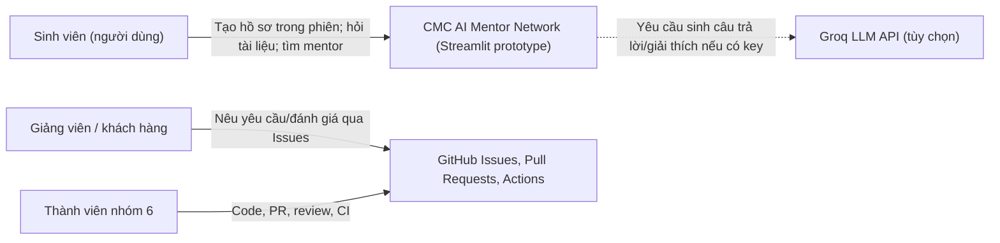
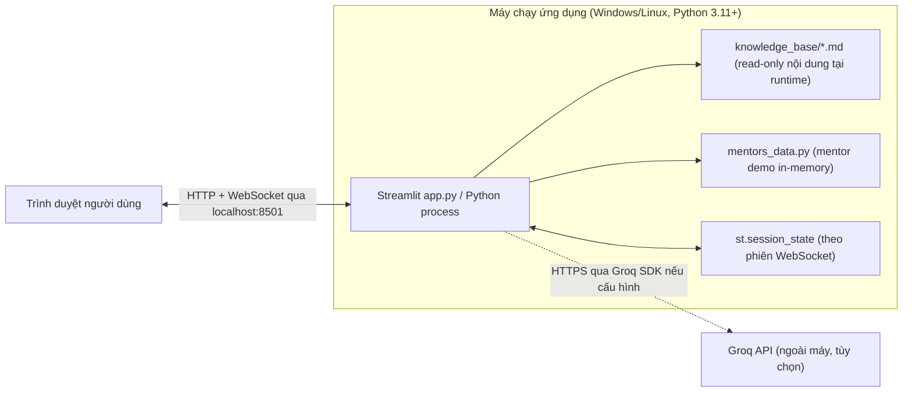
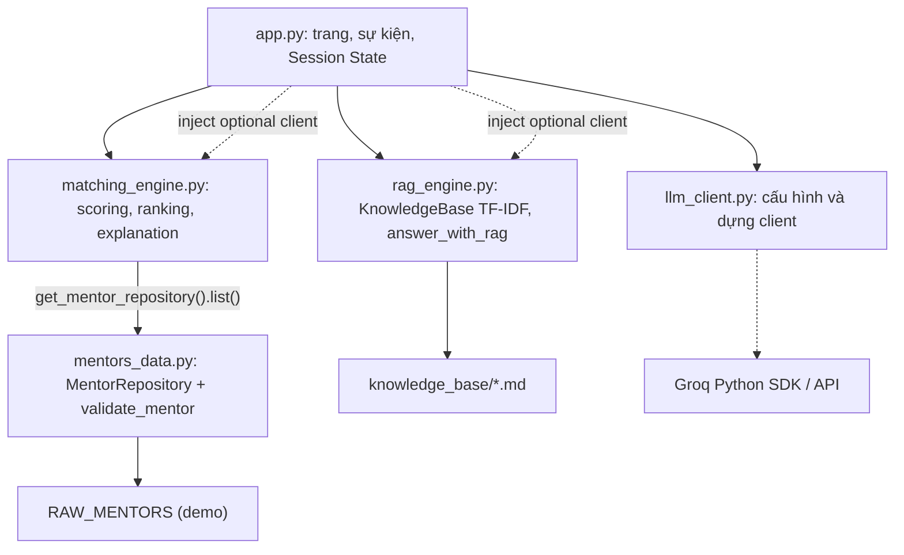
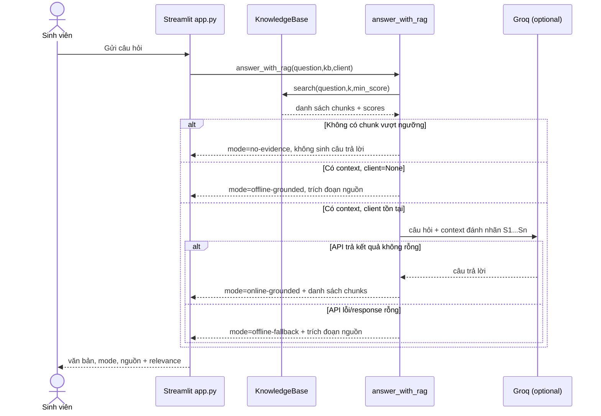
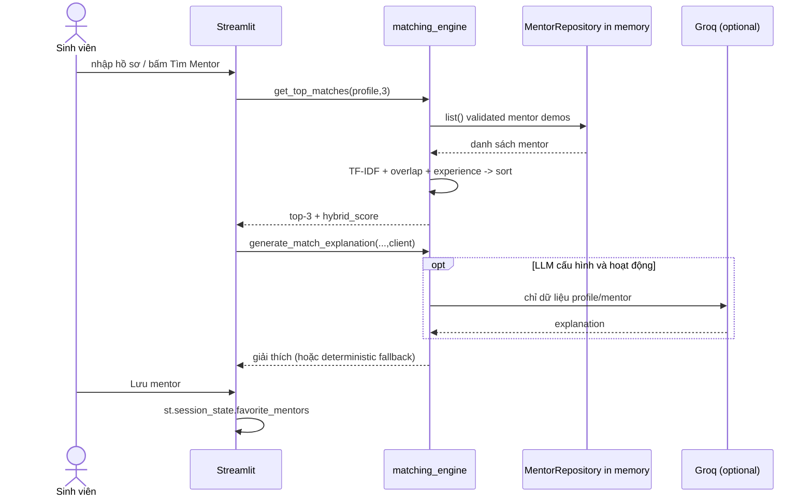

# Kiến trúc phần mềm CMC AI Mentor Network

> **Nguồn chuẩn duy nhất (canonical architecture), phiên bản 2.0, 12/10/2026.**
> Cập nhật từ tài liệu kiến trúc và NFR của thành viên Dương Tuấn Dũng, đối chiếu với mã nguồn `main` hiện có. Lịch sử tác giả vẫn được lưu ở Git commits.
>
> **Phạm vi:** Prototype ứng dụng Streamlit cho hỏi đáp tài liệu có căn cứ và đề xuất mentor trên dữ liệu mô phỏng. Không được giới thiệu như nền tảng quản lý người dùng, đặt lịch/nhắn tin mentor hay dịch vụ SaaS production.

## 1. Phạm vi, tác nhân và chức năng có thật

| Mã | Use case hiện có | Điểm vào | Lưu trữ | Trạng thái |
| --- | --- | --- | --- | --- |
| FR-01 | Xem Dashboard, số tài liệu và trạng thái cấu hình LLM | `app.py` | tính từ runtime | Có |
| FR-02 | Nhập hồ sơ sinh viên (năm học, lĩnh vực, mục tiêu, giới thiệu) | `app.py` | `st.session_state`, chỉ trong phiên | Có |
| FR-03 | Hỏi đáp tài liệu Markdown bằng TF-IDF retrieval, offline snippets hoặc LLM tùy chọn | `rag_engine.py` | files `knowledge_base/*.md` | Có |
| FR-04 | Xem nguồn retrieval và điểm relevance | `app.py` + `rag_engine.py` | trong phiên chat | Có |
| FR-05 | Tính điểm mentor bằng hybrid scoring; xem top-k | `matching_engine.py` | dữ liệu demo qua `mentors_data.py` | Có |
| FR-06 | Lưu/bỏ lưu mentor trong phiên hiện tại | `app.py` | `st.session_state` | Có |
| FR-07 | Tiếp nhận yêu cầu khách hàng và lỗi qua GitHub Issues | `.github/ISSUE_TEMPLATE` | GitHub (không thuộc ứng dụng Streamlit) | Có ở quy trình phát triển |

**Không triển khai trong phiên bản này:** đăng ký/đăng nhập, phân quyền ứng dụng, cơ sở dữ liệu tài khoản, hồ sơ lưu vĩnh viễn, lịch hẹn/nhắn tin mentor, gửi yêu cầu ghép đôi đến mentor, web search trực tuyến, tải và lập chỉ mục tài liệu qua giao diện, báo cáo SLA production. Những mục này chỉ có thể là backlog sau khi khách hàng phê duyệt.

## 2. Quyết định kiến trúc tổng thể

**Modular monolith** chạy trong **một tiến trình Python/Streamlit**, phân tách theo trách nhiệm (không phải microservices, không có REST backend độc lập). Giao diện điều phối các hàm domain; AI bên ngoài chỉ được dùng nếu có cấu hình, không phải điều kiện để ứng dụng khởi động.

Quy tắc dependency:
- `app.py` điều phối, quản lý trạng thái UI, không trực tiếp triển khai ranking/retrieval.
- `rag_engine.py` và `matching_engine.py` nhận client LLM tùy chọn qua tham số; không tự đọc credential.
- `llm_client.py` là ranh giới hạ tầng, tải `.env` và dựng Groq client.
- `matching_engine.py` hiện phụ thuộc **`get_mentor_repository()` trong `mentors_data.py`**, không truy vấn DB.
- `mentors_data.py` chứa dữ liệu demo, `validate_mentor` và `MentorRepository` trong bộ nhớ.
- `rag_engine.py` đọc Markdown trực tiếp từ thư mục `knowledge_base/` (không dùng Chroma/vector database trong bản này).
- `ingest.py` chỉ kiểm tra/diagnostic kho tài liệu, không upload hay ingest database.
- GitHub Actions chạy độc lập lúc commit/PR, không xử lý yêu cầu người dùng tại runtime.

## 3. C4 Level 1: System Context

**Lưu ý:** GitHub Issues là công cụ quản lý dự án riêng biệt, **không tự động tạo dữ liệu hoặc gọi API trong ứng dụng**. Không vẽ luồng `GitHub → App` vì hiện không có webhook/integration.

## 4. C4 Level 2: Container & deployment

Một container logic ứng dụng, một kho dữ liệu file cục bộ, một dịch vụ LLM bên ngoài tùy chọn:

- **Persistence:** file Markdown là nguồn tĩnh trong repo; mentor demo load vào RAM; hồ sơ, lịch sử chat, mentor yêu thích **không được ghi vào DB**. Session State có thể mất khi WebSocket/server/session kết thúc, refresh/restart không được bảo đảm giữ dữ liệu.
- **Secrets:** `GROQ_API_KEY` lấy từ môi trường hoặc `.env` local, không hard-code; `.env` thuộc `.gitignore`. Key cũ có thể còn trong Git history và cần revoke thủ công.
- **Triển khai:** `streamlit run app.py` hoặc `run_windows.bat`. Không có bằng chứng multi-tenant, RBAC, production hosting hay backup.
- **DevOps:** `GitHub Actions` kiểm thử riêng trên Windows và Linux; một HTTP health check chỉ chứng minh máy chủ khởi động, không chứng minh mọi UI path hay độ chính xác câu trả lời.

## 5. C4 Level 3: Component map đối chiếu mã nguồn

| Thành phần | Vai trò được kiểm tra từ code | Contract chính |
| --- | --- | --- |
| `app.py` | Streamlit UI, chọn trang, `session_state`, gọi AI & matching | `get_top_matches`, `answer_with_rag` |
| `llm_client.py` | Cấu hình `GROQ_API_KEY`, tạo `Groq` hoặc trả `None` | `build_llm_client()`, `llm_enabled()` |
| `rag_engine.py` | Markdown chunking, TF-IDF, cosine retrieval, fallback khi thiếu nguồn/API lỗi | `KnowledgeBase.search`, `answer_with_rag` |
| `matching_engine.py` | TF-IDF trên mentor, tính hybrid score, tạo giải thích offline/online | `get_top_matches`, `generate_match_explanation` |
| `mentors_data.py` | Danh sách demo, normalize/validate mentor, repository trong RAM | `get_mentor_repository`, `validate_mentor` |
| `ingest.py` | In thống kê số file/chunk và mẫu retrieval | `main()` diagnostic |
| `tests/` | Unit tests/Streamlit AppTest, không thay thế kiểm thử khách hàng | `python -m pytest -q` |
| `.github/workflows/ci.yml` | Lint-like compile, pytest, CI HTTP smoke, secret pattern guard | Workflow khi PR/push |

**Giới hạn của MentorRepository hiện tại:** đây là abstraction trong bộ nhớ, không phải PostgreSQL/SQLite; nhãn “repository” không đồng nghĩa dữ liệu được lưu bền vững.

## 6. Runtime sequence: RAG

**Không tuyên bố bảo đảm không hallucination:** hiện có prompt ràng buộc nguồn nhưng **chưa có lớp xác thực citation tự động / kiểm chứng từng claim**. Việc trả về `sources` là nguồn *được truy xuất*, không phải bằng chứng rằng LLM đã trích dẫn và suy luận đúng toàn bộ.

## 7. Runtime sequence: Mentor Matching

Công thức đang triển khai:
`score = 0.65 × TF-IDF cosine + 0.25 × domain keyword overlap + 0.10 × experience fit`.
Mỗi thành phần được chặn trong `[0,1]`. Đây là **heuristic score để xếp hạng**, không phải xác suất dự đoán thành công, không phải nhãn được huấn luyện từ phản hồi người dùng.

## 8. Dòng dữ liệu và hợp đồng tối thiểu

- **Profile:** `{name, year, field_interest, goals, bio}` lưu theo phiên Streamlit, chưa có user ID/server database.
- **Mentor:** `{id, name, title, company, field, experience_years, bio, strengths[], available_for[]}`; `validate_mentor` thực hiện kiểm tra/chuẩn hóa đầu vào.
- **Retriever output:** `RetrievedChunk(source, text, score)`, score bằng cosine TF-IDF, ngưỡng mặc định `0.06`.
- **RAG output:** `RAGAnswer(answer, sources, mode, top_score)`, mode thuộc `no-evidence`, `offline-grounded`, `online-grounded`, `offline-fallback`.
- **Session state:** `user_profile`, `messages`, `top_matches`, `match_explanations`, `favorite_mentors`. Không phải database hay bộ nhớ lâu dài.

## 9. An toàn, giới hạn tin cậy và lỗi

| Trust boundary / failure | Kiểm soát đã có | Giới hạn còn tồn tại |
| --- | --- | --- |
| Credentials local → Groq | `.env` ignored, `llm_client.py` khởi tạo client có điều kiện | Secret cũ trong lịch sử Git phải revoke; pattern scan không phải secret scanner toàn diện |
| Markdown không tin cậy → Prompt LLM | prompt tuyên bố nội dung nguồn chỉ là dữ liệu | Prompt injection và citation hallucination chưa được chứng minh loại bỏ |
| API network lỗi / thiếu key | offline deterministic snippets/explanation | Không có provider dự phòng tự động hay SLA online |
| Similarity score thấp | refusal khi không có chunk vượt ngưỡng | `min_score=0.06` là heuristic, chưa có benchmark hiệu chỉnh trên bộ dữ liệu lớn |
| Session bị ngắt/restart | Streamlit quản lý phiên hiện tại | Không có bảo đảm phục hồi lịch sử chat/profile |
| Dataset lỗi | `MentorRepository` kiểm tra các field | Cần tiếp tục kiểm thử trùng ID, giá trị bất thường và đầu vào ác ý |
| Github CI | pytest, startup health Windows/Linux | Không đo tải đồng thời, RAG factual accuracy, xác thực phân quyền ứng dụng |

## 10. NFR và phương án nghiệm thu

Nguồn chuẩn cho **NFR-01 đến NFR-10**: [non-functional-requirements.md](non-functional-requirements.md). Mỗi yêu cầu phải có **metric, workload, điều kiện đo, bằng chứng và trạng thái**. Không chuyển một NFR từ `Chưa xác minh` thành `Đạt` chỉ vì unit tests xanh.

Chất lượng cần kiểm tra từ ít nhất ba lớp: `Unit/Integration`, `UI/E2E scenario`, `Human UAT / benchmark`. Giáo viên đưa ra yêu cầu mới phải tạo GitHub Issue mới với acceptance criteria trước khi sửa.

## 11. ADR: các lựa chọn và trade-off

| ADR | Lựa chọn đã áp dụng | Đánh đổi / ngưỡng cân nhắc thay thế |
| --- | --- | --- |
| ADR-01 | Modular monolith Streamlit | Đơn giản cho nhóm nhỏ; chỉ tách REST services nếu có nhu cầu client khác, scale/process độc lập |
| ADR-02 | TF-IDF + cosine cho retrieval | Dễ tái lập/offline nhưng hạn chế semantic recall; benchmark trước khi chuyển embedding/vector store |
| ADR-03 | Groq là optional infrastructure dependency | Demo offline ổn, nhưng không sinh câu trả lời mới khi thiếu key |
| ADR-04 | Session State thay vì user DB | Triển khai nhanh; không đạt yêu cầu persistence qua restart; nếu có yêu cầu mới phải thiết kế auth+storage |
| ADR-05 | Demo MentorRepository trong RAM | Có interface ổn định; chưa có giao dịch, durability hay concurrency |
| ADR-06 | PR + GitHub Actions làm quality gate | Có traceability/test nhưng cần review người thật và UAT, không đồng nghĩa 0 bug |

## 12. Đề xuất (chưa triển khai)

**Đề xuất riêng, không vẽ vào runtime hiện tại như thành phần đang chạy:**
1. Thêm database cho account/profile/favorites sau khi thống nhất FR & NFR persistence, retention và privacy.
2. Thêm quy trình mentor contact và xác thực quyền/consent khi customer yêu cầu.
3. Đánh giá Recall@k trên benchmark tài liệu trước khi chọn vector DB; chốt citation validator & groundedness evaluation.
4. Thêm phép đo P50/P95 thời gian phản hồi, tải đồng thời và accessibility/UAT; chỉ công bố các ngưỡng khi có kết quả thực nghiệm.

## 13. Đồng bộ tài liệu, bằng chứng & trách nhiệm

- **Tài liệu chuẩn:** `docs/architecture.md` (file này) và `docs/non-functional-requirements.md`.
- **Code source-of-truth:** `app.py`, `rag_engine.py`, `matching_engine.py`, `llm_client.py`, `mentors_data.py`.
- **Kiểm thử/CI:** `tests/` và `.github/workflows/ci.yml`.
- **Lịch sử contributor:** commit gốc `6439cdeb`, `a991dbaf` do Dương Tuấn Dũng (`@TuanDungir`) thực hiện; bản hợp nhất là một lần review, không xóa lịch sử tác giả.
- **Change control:** tạo Issue → branch riêng → kiểm tra mã nguồn/tài liệu → CI → PR review → merge. Mỗi lần thêm chức năng phải cập nhật bảng FR, diagram, NFR và bằng chứng liên quan.
