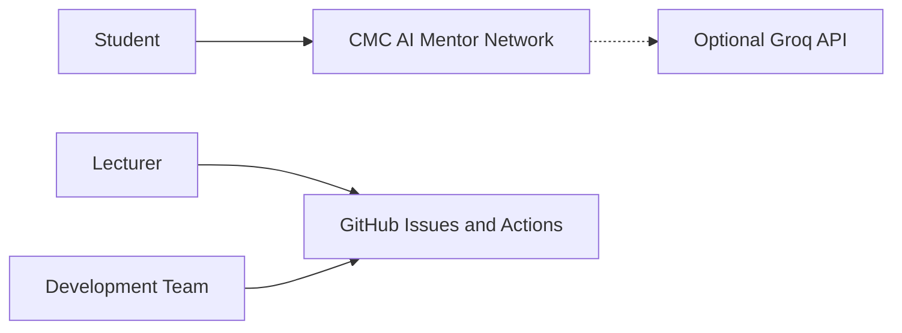
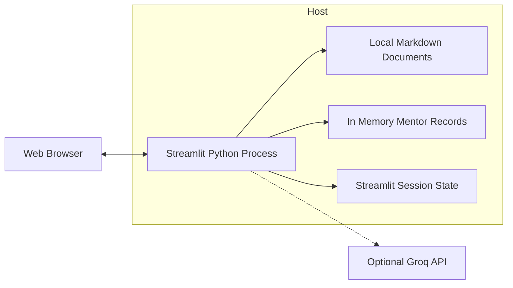
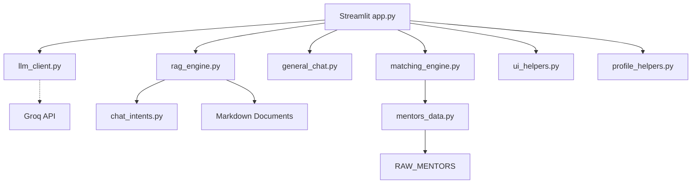
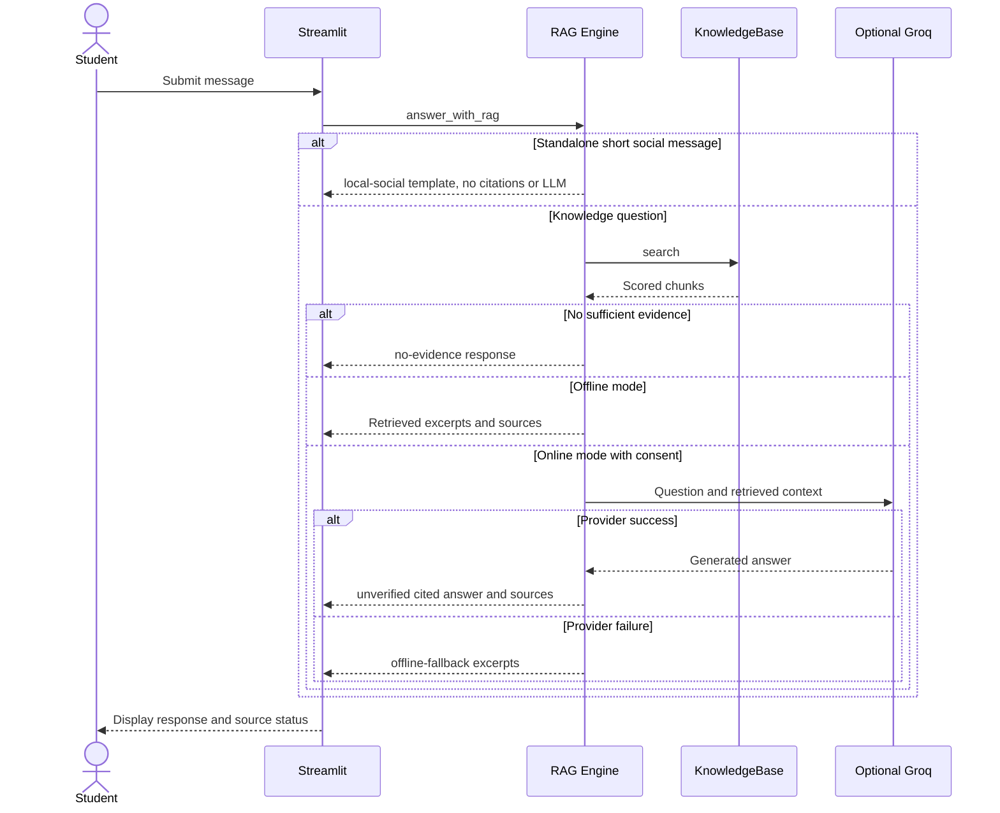
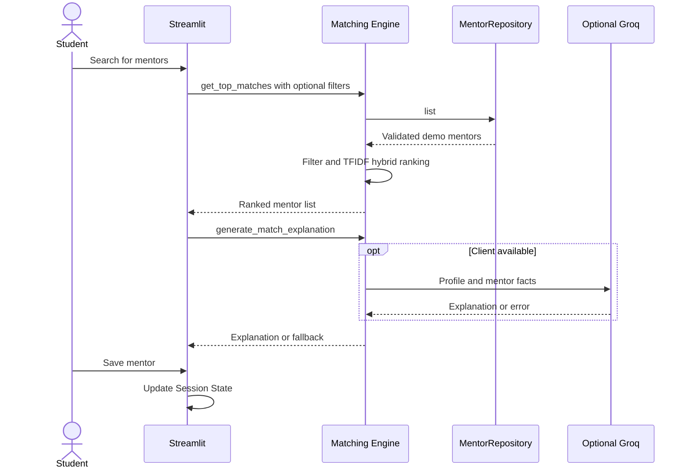

# Kiến trúc phần mềm CMC AI Mentor Network

> **Nguồn chuẩn duy nhất (canonical architecture), phiên bản 2.5, 14/10/2026.**
> Cập nhật từ tài liệu kiến trúc và NFR của thành viên Dương Tuấn Dũng, đối chiếu với mã nguồn `main` hiện có. Lịch sử tác giả vẫn được lưu ở Git commits.
>
> **Phạm vi:** Kiến trúc runtime của **ứng dụng môn học** ở thư mục gốc (Streamlit + RAG + mentor demo). Repo còn chứa các *portfolio labs độc lập* với entrypoint và CI riêng, được liệt kê ở Mục 2.1, không được coi là microservices của ứng dụng môn học. Không được giới thiệu ứng dụng môn học như nền tảng quản lý người dùng, đặt lịch/nhắn tin mentor hay dịch vụ SaaS production.

## 1. Phạm vi, tác nhân và chức năng có thật

| Mã | Use case hiện có | Điểm vào | Lưu trữ | Trạng thái |
| --- | --- | --- | --- | --- |
| FR-01 | Xem Dashboard, số tài liệu và trạng thái cấu hình LLM | `app.py` | tính từ runtime | Có |
| FR-02 | Nhập hồ sơ sinh viên (năm học, lĩnh vực, mục tiêu, giới thiệu) | `app.py` | `st.session_state`, chỉ trong phiên | Có |
| FR-03 | Hỏi đáp tài liệu Markdown bằng TF-IDF retrieval, offline snippets hoặc LLM tùy chọn | `rag_engine.py` | files `knowledge_base/*.md` | Có |
| FR-04 | Xem nguồn retrieval và điểm relevance | `app.py` + `rag_engine.py` | trong phiên chat | Có |
| FR-05 | Tính điểm mentor bằng hybrid scoring; xem top-k | `matching_engine.py` | dữ liệu demo qua `mentors_data.py` | Có |
| FR-06 | Lưu/bỏ lưu mentor trong phiên hiện tại | `app.py` | `st.session_state` | Có |
| FR-07 | Tiếp nhận yêu cầu khách hàng và lỗi qua GitHub Issues | `.github/ISSUE_TEMPLATE` | GitHub (không thuộc ứng dụng Streamlit) | Có ở quy trình phát triển |
| FR-08 | Lọc mentor theo lĩnh vực và loại hỗ trợ trước khi xếp hạng | `app.py` + `matching_engine.py` | demo records trong RAM | Có, theo Issue #18 |
| FR-09 | Validate, đặt lại hồ sơ và xóa chat trong phiên | `app.py` + `ui_helpers.py` + `profile_helpers.py` | `st.session_state` | Có, theo Issues #50/#51 |
| FR-10 | Chẩn đoán độc lập chất lượng dữ liệu mentor | `mentor_data_diagnostics.py` | đọc demo records, không ghi DB | Có dưới dạng CLI, không phải màn hình app |
| FR-11 | Chào hỏi ngắn không cần tài liệu trong chế độ RAG | `chat_intents.py` + `rag_engine.py` | `messages` trong session | Template cục bộ, giới hạn allowlist |
| FR-12 | Chat nhiều lượt bằng mô hình ngôn ngữ thực, tách khỏi RAG | `app.py` + `general_chat.py` + `llm_client.py` | `general_messages` trong session | Có khi có Groq API key và user opt-in |

**Không triển khai trong phiên bản này:** đăng ký/đăng nhập, phân quyền ứng dụng, cơ sở dữ liệu tài khoản, hồ sơ lưu vĩnh viễn, lịch hẹn/nhắn tin mentor, gửi yêu cầu ghép đôi đến mentor, web search trực tuyến, tải và lập chỉ mục tài liệu qua giao diện, báo cáo SLA production. Những mục này chỉ có thể là backlog sau khi khách hàng phê duyệt.

## 2. Quyết định kiến trúc tổng thể

**Riêng ứng dụng môn học ở root** dùng modular monolith chạy trong **một tiến trình Python/Streamlit**, phân tách theo trách nhiệm (không phải microservices, không có REST backend độc lập). Giao diện điều phối các hàm domain; AI bên ngoài chỉ được dùng nếu có cấu hình, không phải điều kiện để ứng dụng khởi động.

Quy tắc dependency:
- `app.py` điều phối, quản lý trạng thái UI, không trực tiếp triển khai ranking/retrieval; `ui_helpers.py` chuẩn hóa lịch sử nguồn và nhãn trạng thái chat, còn `profile_helpers.py` kiểm tra/đặt lại hồ sơ.
- `rag_engine.py`, `matching_engine.py` và `general_chat.py` nhận client LLM tùy chọn qua tham số; không tự đọc credential. Hỏi đáp tài liệu và trò chuyện chung là **hai chế độ độc lập**, không dùng lẫn lịch sử hoặc trích dẫn.
- `llm_client.py` là ranh giới hạ tầng, tải `.env` hoặc nhận **BYOK session credential** từ widget mật khẩu và dựng Groq client. Streamlit sidebar **yêu cầu opt-in rõ ràng mỗi phiên** trước khi chuyển client vào general chat, RAG hoặc matching; cấu hình credential **không** tự cho phép truyền nội dung ra ngoài. Model mặc định là `openai/gpt-oss-120b` trên Groq; model cũ Llama 3.3 không còn mặc định.
- `matching_engine.py` hiện phụ thuộc **`get_mentor_repository()` trong `mentors_data.py`**, không truy vấn DB.
- `mentors_data.py` chứa dữ liệu demo, `validate_mentor` và `MentorRepository` trong bộ nhớ; `mentor_data_diagnostics.py` là công cụ CLI chạy offline kiểm tra riêng, không được gọi từ UI.
- `rag_engine.py` đọc Markdown trực tiếp từ thư mục `knowledge_base/` (không dùng Chroma/vector database trong bản này).
- `chat_intents.py` là bộ phân loại lời chào/cảm ơn/câu hỏi năng lực rất hẹp, không gọi LLM; mọi truy vấn khác vẫn qua `KnowledgeBase.search` và chốt nguồn trước khi trả lời.
- `ingest.py` chỉ kiểm tra/diagnostic kho tài liệu, không upload hay ingest database.
- GitHub Actions chạy độc lập lúc commit/PR, không xử lý yêu cầu người dùng tại runtime.

### 2.1. Ranh giới monorepo với các AI labs độc lập

Tính đến 14/10/2026, các thư mục dưới đây là **dự án portfolio/demo độc lập** được bổ sung trong cùng repository, không phải thành phần được gọi trực tiếp bởi `app.py`. Các lab này có lệnh chạy, dữ liệu giả lập, giới hạn riêng và workflow CI riêng. Việc cùng nằm trong Git repo **không** tạo ra quan hệ runtime giữa các dịch vụ.

| Thư mục | Chức năng độc lập theo code/README | Điểm chạy và CI |
| --- | --- | --- |
| `cagent_lab/` | Retrieval BM25/TF-IDF, tools allowlist, optional embeddings và FastAPI | `python -m cagent_lab.evaluate`, `cagent-lab.yml` |
| `enterprise_doc_ai/` | Document retrieval có scope, trích xuất, workflow demo, API tùy chọn | `python -m enterprise_doc_ai.cli`, `enterprise-doc-ai.yml` |
| `retail_ops_ai/` | Demo retail retrieval, price quotes và tool workflow trên dữ liệu giả lập | `python -m retail_ops_ai.evaluate`, `industry-ai-labs.yml` |
| `edu_trainer_ai/` | Demo retrieval bài học, quiz/rubric và learning path | `python -m edu_trainer_ai.evaluate`, `industry-ai-labs.yml` |
| `model_pretraining_lab/` | Huấn luyện character bigram model từ đầu (không phải Transformer) | `python -m model_pretraining_lab.core`, `model-training-labs.yml` |
| `model_posttraining_lab/` | SFT/DPO thử nghiệm trên checkpoint bigram, dữ liệu synthetic | `python -m model_posttraining_lab.core`, `model-training-labs.yml` |

Các API FastAPI (nếu cài dependency và chạy riêng) chỉ thuộc lab tương ứng. **Không có API gateway/service orchestration tích hợp các lab với Streamlit root**, không có luồng user của ứng dụng môn học sang các lab này. Các tuyên bố về benchmark, tenant isolation và security của từng lab chỉ áp dụng trong phạm vi lab đó; không chuyển sang FR/NFR của sản phẩm môn học. Tài liệu hướng dẫn nằm trong `<lab>/README.md` và [bản adversarial audit](FINAL_ADVERSARIAL_AUDIT.md).

## 3. C4 Level 1: System Context

**Chú giải:** Sinh viên sử dụng ứng dụng Streamlit; giảng viên và nhóm phát triển trao đổi qua GitHub; Groq chỉ được gọi khi có client được cấu hình. Các nhãn sơ đồ dùng tiếng Anh ngắn gọn để tương thích trình render Mermaid, phần diễn giải tiếng Việt nằm trong tài liệu.

**Lưu ý:** GitHub Issues là công cụ quản lý dự án riêng biệt, **không tự động tạo dữ liệu hoặc gọi API trong ứng dụng**. Không vẽ luồng `GitHub → App` vì hiện không có webhook/integration.

## 4. C4 Level 2: Container & deployment

Một container logic ứng dụng, một kho dữ liệu file cục bộ, một dịch vụ LLM bên ngoài tùy chọn:

- **Persistence:** file Markdown là nguồn tĩnh trong repo; mentor demo load vào RAM; hồ sơ, lịch sử chat, mentor yêu thích **không được ghi vào DB**. Session State có thể mất khi WebSocket/server/session kết thúc, refresh/restart không được bảo đảm giữ dữ liệu.
- **Secrets:** `GROQ_API_KEY` lấy từ môi trường hoặc `.env` local, không hard-code; `.env` thuộc `.gitignore`. Key cũ có thể còn trong Git history và cần revoke thủ công.
- **Triển khai:** local qua `streamlit run app.py` / `run_windows.bat`, hoặc **Cloud Render** tại `https://cmc-ai-mentor-network-group6.onrender.com` với một Streamlit Python process (chi tiết trong [CLOUD_DEPLOYMENT.md](CLOUD_DEPLOYMENT.md)). Render Free có thể cold-start và không có tính bền vững dữ liệu session; không có bằng chứng multi-tenant, RBAC, backup hay production-grade SLA.
- **DevOps:** `GitHub Actions` kiểm thử riêng trên Windows và Linux; một HTTP health check chỉ chứng minh máy chủ khởi động, không chứng minh mọi UI path hay độ chính xác câu trả lời.

## 5. C4 Level 3: Component map đối chiếu mã nguồn

| Thành phần | Vai trò được kiểm tra từ code | Contract chính |
| --- | --- | --- |
| `app.py` | Streamlit UI, chọn trang, `session_state`, gọi AI & matching, bộ lọc, chat clear | `get_top_matches`, `answer_with_rag` |
| `ui_helpers.py` | Chuẩn hóa nguồn trong lịch sử chat, nhãn mode và xóa riêng chat trong session | `normalize_saved_source`, `source_history_payload`, `rag_mode_label`, `clear_chat_history` |
| `profile_helpers.py` | Validation hồ sơ, năm học cũ, lưu và reset dữ liệu phiên | `validate_profile_fields`, `safe_student_year`, `save_profile_state`, `reset_profile_state` |
| `llm_client.py` | Cấu hình `GROQ_API_KEY`, tạo `Groq` hoặc trả `None` | `build_llm_client()`, `llm_enabled()` |
| `rag_engine.py` | Markdown chunking, TF-IDF, cosine retrieval, fallback khi thiếu nguồn/API lỗi, tách chế độ nguồn | `KnowledgeBase.search`, `answer_with_rag` |
| `general_chat.py` | Hội thoại mô hình ngôn ngữ nhiều lượt, cửa sổ ngữ cảnh giới hạn, lỗi nhà cung cấp không tiết lộ key | `generate_general_reply`, `build_general_messages` |
| `chat_intents.py` | Cho phép chào hỏi/cảm ơn độc lập bằng template, không truy xuất hay giả vờ là AI online | `local_social_reply` |
| `matching_engine.py` | TF-IDF trên mentor, tính hybrid score, tạo giải thích offline/online | `get_top_matches`, `generate_match_explanation` |
| `mentors_data.py` | Danh sách demo, normalize/validate mentor, repository trong RAM | `get_mentor_repository`, `validate_mentor` |
| `mentor_data_diagnostics.py` | Công cụ báo lỗi trùng ID, thiếu field, sai kiểu trong dữ liệu mentor (chạy CLI độc lập) | `diagnose_mentors`, `format_diagnostic_report` |
| `ingest.py` | In thống kê số file/chunk và mẫu retrieval | `main()` diagnostic |
| `tests/` | Unit tests/Streamlit AppTest, không thay thế kiểm thử khách hàng | `python -m pytest -q` |
| `.github/workflows/ci.yml` | Lint-like compile, pytest, CI HTTP smoke, secret pattern guard | Workflow khi PR/push |

**Luồng phụ thuộc:** `app.py` tạo client (nếu có) qua `llm_client.py`, sau đó inject vào `general_chat.py`, `rag_engine.py` và `matching_engine.py` chỉ khi người dùng đã cho phép. `get_mentor_repository().list()` được gọi bên trong matching. Không có đường truyền API trực tiếp từ trình duyệt tới Groq.

**Giới hạn của MentorRepository hiện tại:** đây là abstraction trong bộ nhớ, không phải PostgreSQL/SQLite; nhãn “repository” không đồng nghĩa dữ liệu được lưu bền vững.

## 6. Runtime sequence: RAG

**Các trạng thái phản hồi của ứng dụng:** `local-social` dành cho lời chào đơn giản được trả bằng template cục bộ, **không có nguồn hay lời gọi Groq**. Các câu hỏi ngoài allowlist tiếp tục đi qua retrieval. **Các trạng thái RAG (đúng theo nhánh `main` hiện tại):** `no-evidence` khi không có chunk vượt ngưỡng; `offline-grounded` khi client chưa cấu hình; `online-citations-unverified` khi API trả lời có ít nhất một citation hợp lệ về **chỉ số nguồn**; `offline-fallback` khi API lỗi hoặc trả về rỗng. Trong sơ đồ, các nhãn ngắn gọn đại diện cho bốn nhánh xử lý này.

**Không tuyên bố bảo đảm không hallucination:** prompt ràng buộc nguồn và `rag_engine.py` hiện có **kiểm tra sự tồn tại của chỉ số citation** (`[S1]` đến `[Sk]`) trong các kết quả retrieval, từ chối câu trả lời thiếu citation hoặc có chỉ số ngoài phạm vi, đồng thời chặn câu trả lời rỗng hoặc quá dài. **Chưa có kiểm chứng ngữ nghĩa từng claim (entailment/faithfulness)**: citation tồn tại không chứng minh nội dung thực sự được nguồn hỗ trợ. `sources` chỉ phản ánh các đoạn được truy xuất.

### 6.1. Hội thoại AI thực (tách khỏi RAG)

- Giao diện mặc định **Trò chuyện AI** sử dụng `general_chat.py` và model `openai/gpt-oss-120b` khi có credential hợp lệ và opt-in. `general_messages` chỉ chứa user/assistant text, không trộn `messages` (lịch sử RAG) hoặc source Markdown.
- `build_general_messages()` giữ tối đa 16 messages và 12.000 ký tự gần nhất; lọc vai trò giả và các câu lỗi. Cửa sổ đó là **ngữ cảnh hội thoại tạm thời**, không phải trí nhớ dài hạn ngoài phiên.
- Khi thiếu key hoặc chưa bật consent, `st.chat_input` của Trò chuyện AI bị vô hiệu hóa, không dùng lời chào hard-code để đóng giả câu trả lời LLM. Người dùng có thể dán Groq key trong widget **mật khẩu** ở sidebar; key tồn tại trong Streamlit Session State ở phía máy chủ (RAM) và được gửi đến Groq khi cho phép. Chưa có bằng chứng kiểm tra xóa key khỏi RAM ngay lập tức khi đóng phiên.
- Trò chuyện AI **không có citation/groundedness** theo tài liệu; kết quả không được gắn các nhãn `offline-grounded` hay `online-citations-unverified`. Muốn kiểm chứng nội dung trong kho Markdown, người dùng chủ động chuyển sang **Hỏi đáp tài liệu**. Hai chế độ có lịch sử riêng và thao tác xóa riêng.
- Đã thay model mặc định Llama 3.3 đã ngừng hỗ trợ ở Free/Developer bằng GPT-OSS 120B. Đây là model open-weight do bên thứ ba phục vụ qua API; không cam kết ngang GPT-6/Gemini/Claude ở tất cả benchmark. Cần key, quota và có thể phát sinh chi phí nhà cung cấp.

## 7. Runtime sequence: Mentor Matching

**Chi tiết luồng matching:** Khi API lỗi, `generate_match_explanation` trả về giải thích deterministic. Khi bấm lưu mentor, ứng dụng cập nhật `st.session_state.favorite_mentors` mà không ghi xuống cơ sở dữ liệu.

Công thức đang triển khai:
`score = 0.65 × TF-IDF cosine + 0.25 × domain keyword overlap + 0.10 × experience fit`.
Bộ lọc theo field/available_for được áp dụng **trước** tính TF-IDF; nếu không có mentor phù hợp thì trả danh sách rỗng. Mỗi thành phần được chặn trong `[0,1]`. Đây là **heuristic score để xếp hạng**, không phải xác suất dự đoán thành công, không phải nhãn được huấn luyện từ phản hồi người dùng.

## 8. Dòng dữ liệu và hợp đồng tối thiểu

- **Profile:** `{name, year, field_interest, goals, bio}` lưu theo phiên Streamlit, chưa có user ID/server database.
- **Mentor:** `{id, name, title, company, field, experience_years, bio, strengths[], available_for[]}`; `validate_mentor` thực hiện kiểm tra/chuẩn hóa đầu vào.
- **Retriever output:** `RetrievedChunk(source, text, score)`, score bằng cosine TF-IDF, ngưỡng mặc định `0.06`.
- **RAG output:** `RAGAnswer(answer, sources, mode, top_score)`, mode thuộc `no-evidence`, `offline-grounded`, `online-citations-unverified`, `offline-fallback`.
- **Session state:** `user_profile`, `messages` (RAG), `general_messages` (trò chuyện model), `top_matches`, `match_explanations`, `favorite_mentors`, `active_mentor_filters`. Không phải database hay bộ nhớ lâu dài. Chức năng xóa chat chỉ xóa `messages`, đặt lại hồ sơ xóa kết quả matching cũ và giữ nguyên favorites.

## 9. An toàn, giới hạn tin cậy và lỗi

| Trust boundary / failure | Kiểm soát đã có | Giới hạn còn tồn tại |
| --- | --- | --- |
| Credentials local → Groq | `.env` ignored, `llm_client.py` khởi tạo client có điều kiện | Secret cũ trong lịch sử Git phải revoke; pattern scan không phải secret scanner toàn diện |
| Markdown không tin cậy → Prompt LLM | prompt xem nguồn là dữ liệu; citation ID phải thuộc các đoạn retrieval; bỏ qua symlink/đường dẫn thoát root và Markdown file >2 MB | Prompt injection và hallucination ngữ nghĩa chưa được chứng minh loại bỏ; threshold là heuristic |
| API network lỗi / thiếu key | offline deterministic snippets/explanation | Không có provider dự phòng tự động hay SLA online |
| Similarity score thấp | refusal khi không có chunk vượt ngưỡng | `min_score=0.06` và ngưỡng OOV/query-term coverage tối thiểu `0.55` là heuristic trên corpus demo nhỏ; có nguy cơ false refusal với từ mới/đồng nghĩa, chưa có benchmark ngoài phân phối |
| Session bị ngắt/restart | Streamlit quản lý phiên hiện tại | Không có bảo đảm phục hồi lịch sử chat/profile |
| Dataset lỗi | `MentorRepository` kiểm tra các field; CLI `mentor_data_diagnostics.py` kiểm tra trùng ID và sai định dạng | Bản CLI là chẩn đoán độc lập, không tự sửa dữ liệu; validator và CLI có chính sách chuẩn hóa/strict khác nhau cần tiếp tục đối chiếu |
| GitHub CI | pytest và health Windows/Linux của ứng dụng gốc; Mermaid render v10/v11; các lab có workflow theo path riêng | Không đo tải đồng thời hay RAG claim accuracy; green ở một workflow không chứng minh lab khác đạt |

## 10. NFR và phương án nghiệm thu

Nguồn chuẩn cho **NFR-01 đến NFR-10**: [non-functional-requirements.md](non-functional-requirements.md). Mỗi yêu cầu phải có **metric, workload, điều kiện đo, bằng chứng và trạng thái**. Không chuyển một NFR từ `Chưa xác minh` thành `Đạt` chỉ vì unit tests xanh.

Chất lượng cần kiểm tra từ ít nhất ba lớp: `Unit/Integration`, `UI/E2E scenario`, `Human UAT / benchmark`. Giáo viên đưa ra yêu cầu mới phải tạo GitHub Issue mới với acceptance criteria trước khi sửa.

## 11. ADR: các lựa chọn và trade-off

| ADR | Lựa chọn đã áp dụng | Đánh đổi / ngưỡng cân nhắc thay thế |
| --- | --- | --- |
| ADR-01 | Modular monolith Streamlit | Đơn giản cho nhóm nhỏ; chỉ tách REST services nếu có nhu cầu client khác, scale/process độc lập |
| ADR-02 | TF-IDF + cosine cho retrieval | Dễ tái lập/offline nhưng hạn chế semantic recall; benchmark trước khi chuyển embedding/vector store |
| ADR-03 | Groq là optional infrastructure dependency | Demo offline ổn, nhưng không sinh câu trả lời mới khi thiếu key |
| ADR-04 | Session State thay vì user DB | Triển khai nhanh; không đạt yêu cầu persistence qua restart; nếu có yêu cầu mới phải thiết kế auth+storage |
| ADR-05 | Demo MentorRepository trong RAM | Có interface ổn định; chưa có giao dịch, durability hay concurrency |
| ADR-06 | PR + GitHub Actions làm quality gate | Có traceability/test nhưng cần review người thật và UAT, không đồng nghĩa 0 bug |

## 12. Đề xuất (chưa triển khai)

**Đề xuất riêng, không vẽ vào runtime hiện tại như thành phần đang chạy:**
1. Thêm database cho account/profile/favorites sau khi thống nhất FR & NFR persistence, retention và privacy.
2. Thêm quy trình mentor contact và xác thực quyền/consent khi customer yêu cầu.
3. Đánh giá Recall@k trên benchmark tài liệu trước khi chọn vector DB; chốt citation validator & groundedness evaluation.
4. Thêm phép đo P50/P95 thời gian phản hồi, tải đồng thời và accessibility/UAT; chỉ công bố các ngưỡng khi có kết quả thực nghiệm.

## 13. Đồng bộ tài liệu, bằng chứng & trách nhiệm

- **Tài liệu chuẩn:** `docs/architecture.md` (file này) và `docs/non-functional-requirements.md`.
- **Code source-of-truth:** `app.py`, `ui_helpers.py`, `profile_helpers.py`, `chat_intents.py`, `general_chat.py`, `rag_engine.py`, `matching_engine.py`, `llm_client.py`, `mentors_data.py`; CLI `mentor_data_diagnostics.py`.
- **Kiểm thử/CI:** `tests/` và `.github/workflows/ci.yml` cho root, các workflow `.github/workflows/*lab*.yml` hoặc `industry-ai-labs.yml` cho module độc lập. Mermaid được kiểm tra từ `scripts/validate_mermaid.mjs` trên Chromium.
- **Lịch sử contributor:** commit gốc `6439cdeb`, `a991dbaf` do Dương Tuấn Dũng (`@TuanDungir`) thực hiện; bản hợp nhất là một lần review, không xóa lịch sử tác giả.
- **Change control:** tạo Issue → branch riêng → kiểm tra mã nguồn/tài liệu → CI → PR review → merge. Mỗi lần thêm chức năng phải cập nhật bảng FR, diagram, NFR và bằng chứng liên quan.

### 13.1. Regression, benchmark và giới hạn của bản tích hợp

- `tests/test_issue_batch.py`: UI/session/filter/citation membership. `tests/test_mentor_data_diagnostics.py`: mentor data CLI.
- `scripts/evaluate_rag.py` và `docs/RAG_EVALUATION.md`: tập smoke benchmark offline, không đo LLM faithfulness hay tổng quát hóa.
- `docs/TEST_PLAN.md`, `docs/UAT_CHECKLIST.md`, `docs/PRIVACY_DATAFLOW.md` mô tả kiểm thử và xử lý dữ liệu. UAT chưa có kết quả từ người tham gia thì không được tuyên bố PASS.
- Ứng dụng chỉ giữ dữ liệu trong session, không được coi là xử lý deletion bên provider bên ngoài hoặc lưu bền vững.
